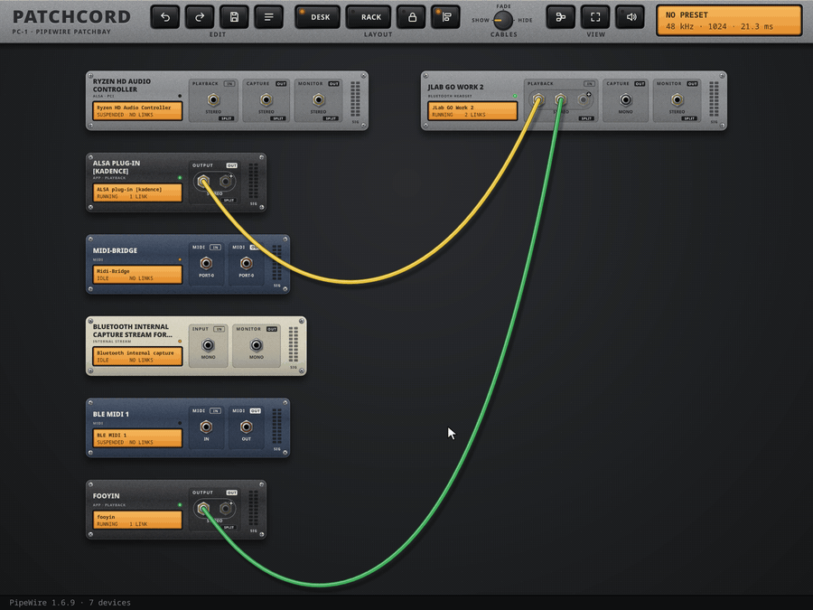
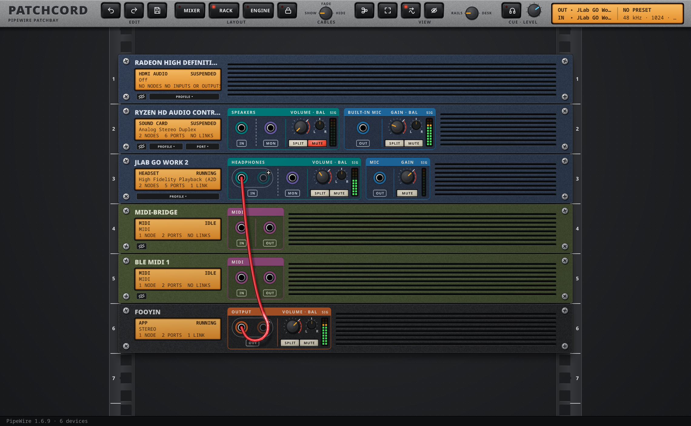
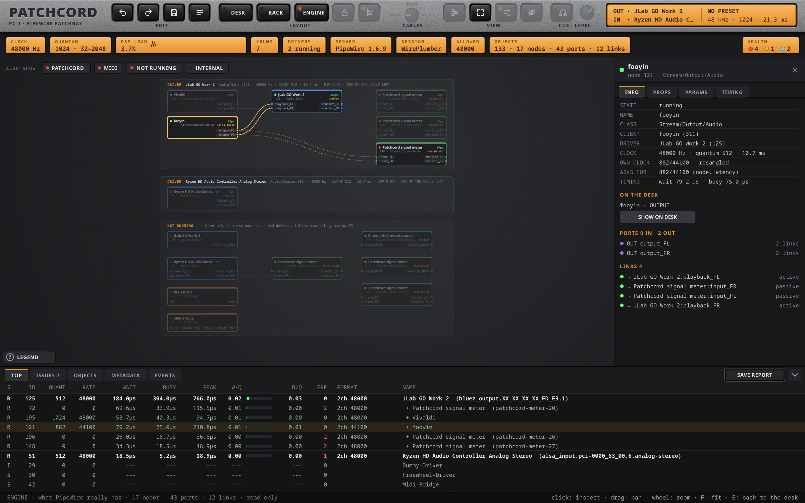

<div align="center">


# Patchcord

**A PipeWire patchbay that looks like a rack of real gear.**<br>
Every device is a hardware panel with 6.3 mm jacks, and every connection is a patch cord that
hangs, swings and settles like a real one.

[](LICENSE)




<a href="docs/screenshots/rack.png"></a>
<a href="docs/screenshots/engine.png"></a>

</div>

Patchcord shows the live PipeWire graph, audio and MIDI, with signal meters and the state of each
device. You patch it with the mouse, on a desk or in a 19" rack, and keep your setups as presets.
It also does what pavucontrol does, built into the panels: the volume (or recording gain),
balance and mute of each app and each device beside its jacks, a sound card's profile and ports,
and the default output and input on the top panel. ENGINE shows what PipeWire really has under
the panels: every node, port and link, grouped by the driver that clocks them, with timings,
xruns and what looks wrong. What comes next is in the [issues](https://github.com/bewzaalex/patchcord/issues). The design is the
interactive mockup in [docs/design/mockup](docs/design/mockup/index.html).

## Installation

Every [release](https://github.com/bewzaalex/patchcord/releases/latest) has packages for x86_64
PCs. Download the one for your system from the release's **Assets** and install it as below.
Patchcord needs PipeWire running, and a GPU with Vulkan (OpenGL is the fallback).

### Flatpak

Works on any Linux distribution with Flatpak. It fetches the freedesktop runtime from Flathub if
you don't have it yet:

```sh
flatpak install --user patchcord-*-x86_64.flatpak
```

The Flatpak reaches PipeWire through its socket, so it can see and connect every device and
program. To uninstall: `flatpak uninstall --user io.github.bewzaalex.patchcord`.

### Debian and Ubuntu

For Ubuntu 24.04 and Debian 13 or newer (older ones: use the Flatpak).

```sh
sudo apt install ./patchcord_*_amd64.deb
```

To uninstall: `sudo apt remove patchcord`.

### Fedora and openSUSE

For Fedora 40 and openSUSE Leap 16 or newer, and Tumbleweed (older ones: use the Flatpak).

```sh
sudo dnf install ./patchcord-*.x86_64.rpm        # Fedora
sudo zypper install ./patchcord-*.x86_64.rpm     # openSUSE
```

To uninstall: `sudo dnf remove patchcord` or `sudo zypper remove patchcord`.

### Other Linux

The `.tar.gz` holds the program, which runs on any distribution with glibc 2.39 and PipeWire
1.0 or newer (2024 and later), with its icon and desktop entry:

```sh
tar -xzf patchcord-*-x86_64-linux.tar.gz
./patchcord-*-x86_64-linux/patchcord
```

To add it to the application launcher, see [below](#add-it-to-the-application-launcher).

With every package, Patchcord appears in the application launcher with its icon (the `.tar.gz`
once you add it). There are no automatic updates yet: to update, install the package from a newer
release the same way.

### From source

You need [Rust](https://rustup.rs) 1.87 or newer, the PipeWire development files and libclang
(the `pipewire` crate generates its bindings at build time): `pipewire` and `clang` on Arch,
`media-video/pipewire` and `llvm-core/clang` on Gentoo, `libpipewire-0.3-dev` and `libclang-dev`
on Debian and Ubuntu, `pipewire-devel` and `clang-devel` on Fedora.

```sh
git clone https://github.com/bewzaalex/patchcord.git
cd patchcord
cargo run --release
```

The first build downloads the dependencies and takes a minute or two. After that you can start
the program directly with `./target/release/patchcord`.

### Add it to the application launcher

The packages do this for you. For the `.tar.gz` or a build from source, install Patchcord for
your user with its icon and launcher entry (on Wayland the desktop shows an application's icon
only once its desktop entry is installed).

From the unpacked `.tar.gz`:

```sh
cd patchcord-*-x86_64-linux
install -Dm755 patchcord ~/.local/bin/patchcord
install -Dm644 -t ~/.local/share/applications io.github.bewzaalex.patchcord.desktop
install -Dm644 -t ~/.local/share/icons/hicolor/scalable/apps io.github.bewzaalex.patchcord.svg
```

From the source folder:

```sh
cargo build --release
install -Dm755 target/release/patchcord ~/.local/bin/patchcord
install -Dm644 -t ~/.local/share/applications assets/io.github.bewzaalex.patchcord.desktop
install -Dm644 -t ~/.local/share/icons/hicolor/scalable/apps assets/icons/io.github.bewzaalex.patchcord.svg
```

To uninstall, delete those three files.

## Using it

### Devices and their frames

Every device is a panel; each of its nodes is one frame, as it is one block in ENGINE: every port
of the node in it, its inputs at the left, its outputs at the right, a monitor beside the input it
copies, each group of ports with its jacks and, for audio, its own SIG meter (what comes in, or
what goes out, after its volume or gain).

| | |
| --- | --- |
| Programs | everything one program makes in PipeWire is one device, APP on its screen, under the program's own name (`application.name`): its streams, its own sinks and sources, its effects (Easy Effects), a DAW's engine (Bitwig). A program is known by its name, binary and process, as PipeWire gives them; PipeWire's own processes and WirePlumber are not programs, their nodes stay devices of their own. Two programs of one name (two VLCs): the first keeps it, the next is numbered (VLC MEDIA PLAYER 2) |
| On a program's face | all its nodes, nothing hidden: a program that wires its own nodes together (Easy Effects) shows them in the order its sound goes through them, each node's IN then its OUT, its own cords running between them on the face; any of them can be patched by hand. A program whose nodes aren't linked among themselves (an app's streams) has its inputs at the left and outputs at the right, as every face |
| Frame names | an app's say which way the sound goes: INPUT, OUTPUT; a program with several nodes names each frame as it named the node (EASY EFFECTS SINK, SPECTRUM), two of a name kept so. A sound card's say what it is, from the port in use, and follow it: SPEAKERS, HEADPHONES, HDMI, BUILT-IN MIC, MIC (SOUND OUT / SOUND IN when the card doesn't tell). A Bluetooth headset has HEADPHONES and MIC. WirePlumber's MIDI bridge is one frame, a jack for each MIDI client on it, named in its tag (IN · MIDI THROUGH, OUT · HYDROGEN) |
| GRAPH key | on a frame's band before its name, its node's number (#180): opens ENGINE with that block chosen and in view |
| Screen | four lines: what the device is and its state (RUNNING); a card's profile (scrolling when long) or what it carries (STEREO, MONO, MIDI, or 2 CH for channels that don't say they're L and R); what it takes of PipeWire (2 NODES 6 PORTS); its cords (2 LINKS), or the volume while it changes |
| IN / OUT / MONITOR tags | under the jacks, what each port is: into it (IN), out of it (OUT), a copy of what goes in (MONITOR), each outlined; a split pair's rows are IN L, IN R |
| MONITOR | beside the input it copies, after a dotted rule (a sound card's, a virtual sink's, an app's recording stream's): to record or listen to it (PipeWire's monitor) |
| OUTPUT 1, OUTPUT 2… | an app with several streams of a kind (Teams in a call records on two and plays on six) is one device with a numbered frame for each, each with its own controls and meter |
| Units | up to four frames side by side; more make the device two or three units high, the frames spread evenly (eight: two units of four), inputs first and outputs last, vents where a unit has nothing to show |
| Colours (K) | a frame's band and outline in its block's kind, as in ENGINE: a sink teal, a source blue, a playback stream brown, a recording stream green, MIDI plum, video ochre, a duplex block magenta, a node without a class sand; or plain frames. A jack's ring is what its port is for, either way: a sink's input teal, a source's output blue, a monitor violet, any other input green and output brown, MIDI plum, video ochre, a port of a format Patchcord doesn't know sand |
| Paint | who owns the device: hardware aluminium, a program black, a node of PipeWire's or WirePlumber's own (a MIDI bridge) olive |
| HIDE key | the struck-through eye at the left of the keys under a device's screen, on every device (or H over it), hides a device without cords; with cords it is dimmed. Hidden devices stay hidden after a restart and come back by themselves when something connects to them |
| HIDDEN key | the eye on the top panel (or H over the desk), with how many are hidden: click one to show it again. It also lists, dimmed and marked SYSTEM, what Patchcord always leaves out: other programs' level meters and its own, and the plumbing behind a Bluetooth headset's MIC |

### Patching

| | |
| --- | --- |
| Drag from a jack's free slot | pull out a cord; drop its end on a jack to link (the jacks it fits glow, the others fade; a jack already patched to it takes no second cord) |
| Drag a cord's end | move it to another jack, or drop it in empty space to unlink |
| Double-click a cord or its end | pull it out (unlink) |
| Drag a cord | grab it and swing it |
| SPLIT / JOIN | one stereo jack, or separate L and R jacks, L above R (a frame's input and the MONITOR inside it together); the stereo jacks its cords lead to follow, and theirs in turn, and so does a new stream that starts playing into a split pair. On a frame with controls it sits beside MUTE |
| FLOW key (W) | which way each cord goes: a light runs inside every plugged-in cord from its output to its input, one at a time; on by default |
| Hover a jack, cord or device | its cords stand out (even with CABLES on fade or hide) and the others fade; after a moment a tooltip gives the full names |
| Ctrl+Z / Ctrl+Shift+Z | undo / redo |

### Volume, balance, mute

| | |
| --- | --- |
| VOLUME / GAIN knob | in each frame with controls: VOLUME on what plays (an app's OUTPUT, a card's SPEAKERS), GAIN on what comes in (an app's INPUT, a MIC). A sound card's are its own hardware volume, as pavucontrol sets it. From silence to 153% (red past 100%: it can clip): drag up or down (Shift: fine), or the wheel (5%, Shift: 1%); it rests at 100% for a moment, and a double-click sets 100%. The screen shows the value in % and dB while it changes |
| BAL knob | on stereo: the balance between L and R. A push-push knob, as on an old car stereo: click to pop it out, then turn it like VOLUME; click again to push it back in, where it can't be turned by accident |
| MUTE key | silences it; its LED lights red |

### Sound cards

| | |
| --- | --- |
| PROFILE ▾ | which inputs and outputs the card has (analog or HDMI, Bluetooth hi-fi or headset) and, for Bluetooth, its codec; profiles with nothing plugged in are marked. The list stays open to try another; a click elsewhere, Esc or the wheel closes it. A card that is off shows too, so it can be switched on |
| PORT ▾ | where an output plays (speakers, headphones) or an input records from (built-in or plugged-in microphone), unplugged ones marked, and each port's latency offset (− and +, 10 ms with Shift) |
| OUT ▸ / IN ▸ | on the top panel's screen: the default output and input, where new apps play and record. Click for the list: click one to make it the default, or ⌖ to glide to it |

### Listening (cue)

| | |
| --- | --- |
| Hold Alt over the jacks | the jack under the pointer plays in the default output, like a test probe, while Alt is held; a cyan ring with headphones marks it. With Alt held the desk only listens: no cord is touched |
| CUE key · LEVEL | CUE mode (LED lit): hover a jack to hear it, click it to keep it playing (filled cyan; as many as you like, mixed); CUE again or Esc stops them all. LEVEL sets how loud, without touching any app's or device's volume. The output you listen on, and its MONITOR, can't be heard (they would feed back); listening only hears what already flows |
| Patching in CUE mode | a jack's black hole still patches (the pointer turns into a crosshair): pull a cord out, move it, plug a new one; the ring round it listens. What is heard follows the new patch |
| In ENGINE | in CUE mode click a port to hear it, again to stop (the port a click would take is framed; red where it would feed back). One port is one channel: FL in the left ear, FR in the right, the rest in both; an input port hears what comes into it. A jack and its ports are one sound: kept on in either place, it stops in either; one channel of a stereo jack kept on fills half of its disc |

### The desk and the rack

| | |
| --- | --- |
| Drag a device | on the desk it stops at other devices and slides along them, and sticks lightly to their edges and centres, with a guide line (G: place freely; ALIGN is off in the rack). In the rack it takes another slot (into the other rack too), the rest making room; near the window's top or bottom the rack scrolls under it |
| R, or DESK / RACK | devices on a desk, or screwed into a 19" rack (each keeps its desk place) |
| The rack | the window is the rack, always at 100%: its rails at the window's sides, units numbered from the top. Every face is as wide as the rack: vents take what its frames don't need (all of it on a card that is off), and frames that don't fit go on to another unit (2U, 3U…): the lower units fill first, the whole width (under the name and screen too), the unit beside the name takes only what is left over; in each unit the frames go from the left (inputs, then outputs), vents after them. A face is at least as wide as its name and screen, or its widest frame (on a unit of its own): only a narrower window scrolls sideways (Shift+wheel, or drag). When the devices don't fit the window's height in one rack, racks stand side by side, as many as it takes (each still as wide as its widest device needs), the devices going down the first and on into the next, split so the racks come out evenest. ARRANGE puts the devices in the order of the signal flow (sources at the top). It goes no higher than its first device; below, as far as its last device or the lowest cord (further while the window is taller) |
| Wheel in the rack | scrolls it up and down (the rack doesn't zoom); bars at the window's edges show there is more. While it scrolls, a knob passing under the pointer isn't turned. Carrying a plug near the top or bottom edge scrolls the rack that way, to reach a device out of sight |
| MORE ▾ | in a narrow window the top panel makes room: the logo goes first, then the keys the screen can't use, then groups fold into MORE from the right. MORE drops them below the panel as they are |
| A, or ARRANGE | devices with cords in columns by signal flow (sources left), ordered so cords cross less; the unused ones after them, kind by kind (sound cards, apps, MIDI), in rows shaped to the window so the faces come out as big as they can |
| F | fit everything in the window; in the rack, back to its top |
| L | lock devices in place |
| C, or CABLES | cords shown, faded or hidden |
| Drag empty space, or right/middle drag · wheel | pan · zoom |
| Ctrl+S / Ctrl+O, or the LCD | save a new preset / pick one from the list |
| Esc · Ctrl+Q | close a list, leave CUE mode · quit |

### ENGINE: what PipeWire really has

ENGINE (E) shows PipeWire's own graph, read-only, for when you want to know what is really going
on: what the panels leave out, which clock drives what, and why something crackles.

| | |
| --- | --- |
| Blocks | a block per node, grouped under the driver that clocks it (NOT RUNNING: nothing clocks it now, no CPU used). Coloured by its kind, as its frame on the rack (sink, source, playback, recording, MIDI, video, duplex, no class), Patchcord's own meters and cue too (tagged PATCHCORD). Its ports are ears on its edges, inputs left, outputs right, each in its group's colour, as its jack's ring; a light shows if it runs, idles, sleeps or had xruns |
| Where they go | by their links as they are now, left to right: no links; only links out; links in and out, a column further for each step along; only links in, then Patchcord's meters and cue. Each group takes as many columns as fit a wide view, and no link runs through another block's port. When the graph changes, the blocks glide to their new places |
| Links | one curve each, in the colour of the port they come out of; faded when paused, dashed when they only listen (meters, the cue), red when the ends share no format |
| Click | a node, port or link turns amber with what belongs to it, and its details open on the right: INFO, PROPS, PARAMS, TIMING, where it is on the desk (SHOW ON DESK goes there), its ports and links |
| ALSO SHOW | Patchcord's meters, MIDI, what isn't running, PipeWire's internal drivers, on and off |
| The strip | the clock, the quantum, the DSP load with its last 45 seconds, xruns, then (when there is room) drivers, server, session, allowed rates and objects; in a narrow window those are behind **i**. HEALTH counts errors, warnings and notes |
| DIAGNOSTICS | the tables below: TOP (as `pw-top`: each driver and its nodes, the last half second's timings), ISSUES (what looks wrong, worst first, with what to do), OBJECTS, METADATA, EVENTS. **SAVE REPORT** writes it all to a text file in your home folder for a bug report, without your user and host names, MAC addresses or the titles of what plays |
| ? or LEGEND | how to read the graph: colours, lights, links, tags, groups |
| Drag · wheel · F · Esc | pan · zoom · fit · deselect; E or DESK / RACK goes back |

Settings and presets are plain text files in `~/.config/patchcord`: `settings.txt` (cords, lock,
lining up, colours, the cord lights, desk or rack, window size, where devices sit, the rack's order, hidden devices) and `presets.txt` (each preset's links, split jacks, layout, volumes, the
cards' profiles and ports, and the default output and input, by PipeWire's names). Loading a
preset takes away the links between devices it knows that it doesn't have; devices started later
keep theirs. The Flatpak keeps them in `~/.var/app/io.github.bewzaalex.patchcord/config/patchcord`
instead.

`patchcord --render out.png [rack] [demo] [split] [hover | held] [save | presets | defaults | hidden] [profile[=NAME]] [port[=NAME]] [only=NAME,…] [size=WxH]`
draws the current graph to a PNG without opening a window, with its live signal levels: in the
rack, with a few cords added to the picture only (`demo`, for screenshots), every stereo jack
split, the pointer on a jack, a cord's end in the hand, a drop-down or a card's list open, only
some devices, or at a given size (`PATCHCORD_SCALE` sets the scale, 1.5 by default).
`patchcord --render out.png engine [select=NODE] [tab=top|issues|objects|metadata|events]
[itab=info|props|params|timing] [shut=bottom] [legend] [info] [size=WxH]` draws ENGINE the same
way, after letting PipeWire's profiler run for two seconds; MAC addresses in names are masked.
`patchcord --record DIR` plays a short scripted session on the current graph and saves it as
frames for the README's animation; neither changes anything in PipeWire. `PATCHCORD_DEBUG=1`
prints which GPU it uses and PipeWire's errors that are otherwise expected noise;
`PATCHCORD_FRAMES=1` prints every slow frame and what took the time (or `PATCHCORD_FRAMES=FILE`
writes it to a file), for reports about the app feeling slow.

### Bluetooth headsets: when the microphone switches on

A Bluetooth headset can't play in high quality and use its microphone at the same time: its
hi-fi profile (A2DP) has no microphone, and its headset profile (HSP/HFP) has one but sounds
like a phone call. Its MIC is there in every profile, and PipeWire's session manager,
WirePlumber, switches the profile by itself: to the headset profile when an app's input gets
connected to MIC, and back to hi-fi when that cord goes. (Behind MIC is WirePlumber's own
plumbing, the real microphone and a capture stream, listed under SYSTEM in the HIDDEN list.) Patchcord leaves this to
WirePlumber, and shows each switch on the card's screen and in its PROFILE list.

WirePlumber looks again only when a cord to a recording app comes or goes, not when the app
starts or stops recording. Many recording apps, DAWs among them, keep their input open between
takes. So if you switch back to hi-fi by hand while such an app is still connected, it stays
in hi-fi the next time you record, and the recording is silent. To get the microphone back,
pick the headset profile with PROFILE ▾, or pull the cord out of the app's INPUT and plug it
back in: WirePlumber then switches again.

## Development

Bugs and plans are [issues on GitHub](https://github.com/bewzaalex/patchcord/issues), the Flatpak build in
[packaging/flatpak](packaging/flatpak/README.md), and how releases are made in
[docs/RELEASING.md](docs/RELEASING.md).

## License

MIT, see [LICENSE](LICENSE). The Noto fonts in `assets/fonts` are under the SIL Open Font License
(`assets/fonts/OFL.txt`).
